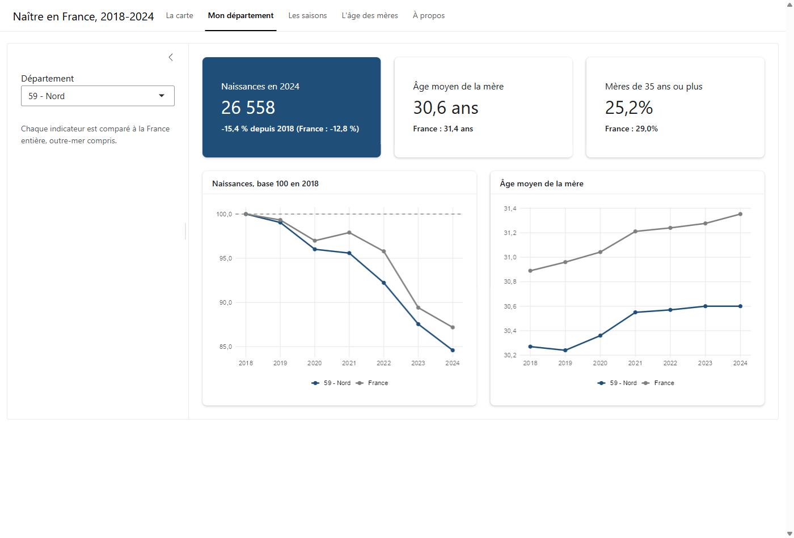

# Les naissances en France, 2018-2024

Roman Delbare et David Doe · Master SIAD, Université de Lille · avril 2026

Projet du cours de datavisualisation, en deux parties : raconter les naissances en France en quatre graphiques, faits avec R et ggplot2 à partir des fichiers détail de l'INSEE. Pour chaque graphique, on explique nos choix, ce que l'IA nous a proposé, ce qu'on a gardé ou refusé, et les limites du résultat. Puis une application Shiny pour explorer les mêmes données par département, par mois et par âge.

## Les quatre questions

| # | Question | Graphique | Ce qu'on voit |
|---|---|---|---|
| 1 | D'où vient le nom des enfants nés en 2021 ? | Barres, une facette par sexe | 80,6 % des enfants portent le nom du père seul. Le double nom « père puis mère » (10,1 %) passe loin devant le nom de la mère seul (6,3 %). Aucune différence entre filles et garçons. |
| 2 | Comment se répartissent les naissances entre les départements ? | Carte de France métropolitaine, avec un zoom sur l'Île-de-France | De 430 naissances en Lozère à 41 880 à Paris. Attention : c'est un nombre de naissances, il suit surtout la taille de la population. |
| 3 | Où se situe 2021 dans l'évolution récente ? | Courbe 2018-2024 | Une baisse presque continue, de 758 590 naissances en 2018 à 660 787 en 2024. 2021 marque un léger rebond après 2020. |
| 4 | L'âge du père suit-il celui de la mère ? | Nuage de 10 000 naissances, droite de régression et diagonale x = y | Oui (corrélation d'environ 0,7). Les pères ont en moyenne 2,7 ans de plus que les mères (33,9 contre 31,2 ans). |

## L'application Shiny : « Naître en France, 2018-2024 »

Les quatre graphiques figent une année et un angle. L'application laisse le lecteur explorer lui-même, avec une règle : comparer ce qui est comparable.

| Onglet | Ce qu'on peut faire | Ce qu'on y apprend |
|---|---|---|
| La carte | Choisir un indicateur et une année, faire défiler les années, mettre un département en évidence | Entre 2018 et 2024, les naissances baissent dans tous les départements de métropole, de −6,1 % en Mayenne à −21,5 % à Paris. |
| Mon département | Choisir un département et le comparer à la France | Exemple : le Nord perd 15,4 % de naissances (France : −12,8 %) et ses mères sont plus jeunes que la moyenne (30,6 ans contre 31,4). |
| Les saisons | Comparer les années mois par mois, en naissances par jour | Les naissances chutent en janvier et février 2021 : ces enfants auraient été conçus pendant le premier confinement. |
| L'âge des mères | Superposer la répartition des âges de plusieurs années | L'âge moyen de la mère passe de 30,9 à 31,4 ans entre 2018 et 2024. Le double nom « père puis mère » progresse. |



Deux choix de méthode :

- **Les naissances sont rattachées au département où vit la mère**, pas à celui de la maternité. Sinon, la fermeture d'une maternité fait « disparaître » des naissances d'un département pour les faire apparaître chez le voisin.
- **L'application ne lit jamais les 5 millions de lignes.** Le script `shiny/preparer_donnees.py` les agrège une fois en petites tables (`shiny/donnees_app/`, 540 Ko au total). L'application démarre en quelques secondes et peut être hébergée gratuitement (shinyapps.io). La carte est dessinée avec ggplot2 à partir des contours de l'IGN, sans dépendre du package `sf`.

Lancer l'application (les tables sont déjà dans le dépôt) :

```r
install.packages(c("shiny", "bslib", "dplyr", "tidyr", "ggplot2", "scales"))
shiny::runApp("shiny")
```

Pour refaire les tables à partir des fichiers de l'INSEE : `source("telecharger_donnees.R")` dans R, puis `python shiny/preparer_donnees.py`.

## Contenu du dépôt

| Fichier | Rôle |
|---|---|
| `naissances_france.Rmd` | Le code R commenté : préparation des données, les quatre graphiques, l'apport de l'IA et notre regard critique. |
| `telecharger_donnees.R` | Télécharge les fichiers de l'INSEE dans `donnees/`. |
| `donnees/DEPARTEMENT.*` | Contours des départements (IGN), utilisés pour la carte. |
| `shiny/app.R` | L'application Shiny. |
| `shiny/preparer_donnees.py` | Agrège les fichiers de l'INSEE en petites tables pour l'application. |
| `shiny/donnees_app/` | Les tables agrégées et les contours simplifiés des départements. |
| `shiny/captures/` | Captures d'écran de l'application. |

## Relancer le projet

Il faut R (4.3 ou plus) et les packages `tidyverse`, `sf`, `patchwork`, `ggrepel` et `scales`.

```r
install.packages(c("tidyverse", "sf", "patchwork", "ggrepel", "scales"))
source("telecharger_donnees.R")   # environ 360 Mo
rmarkdown::render("naissances_france.Rmd")
```

L'échantillon du graphique 4 est tiré avec une graine fixe : on retrouve le même graphique à chaque exécution.

## Sources

- INSEE, état civil, fichiers détail des naissances 2018 à 2024 ([exemple : 2021](https://www.insee.fr/fr/statistiques/6652024?sommaire=6652160)).
- IGN, contours des départements ([géoservices](https://geoservices.ign.fr/documentation/diffusion/telechargement-donnees-libres.html)).

## Limites

- La carte montre des effectifs et non un taux de natalité. Pour comparer vraiment les départements, il faudrait rapporter les naissances à la population.
- Les départements d'outre-mer (5,4 % des naissances de 2021) ne sont pas sur la carte.
- La palette, assez proche en nuances de bleu, peut être difficile à lire pour une personne daltonienne.
